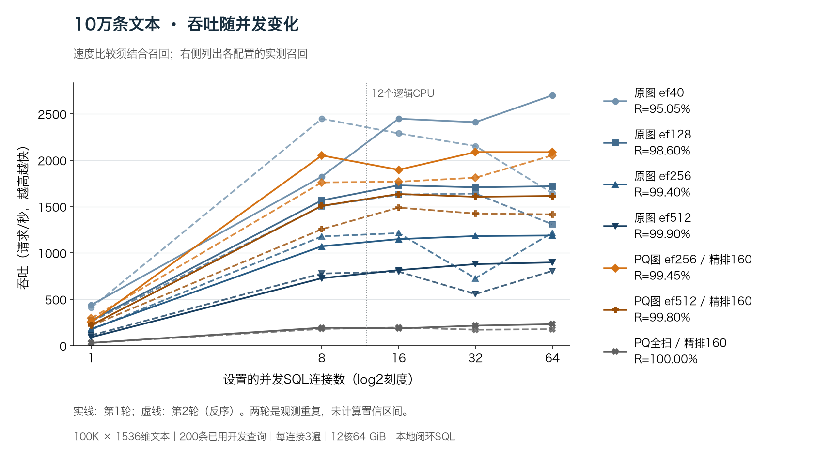
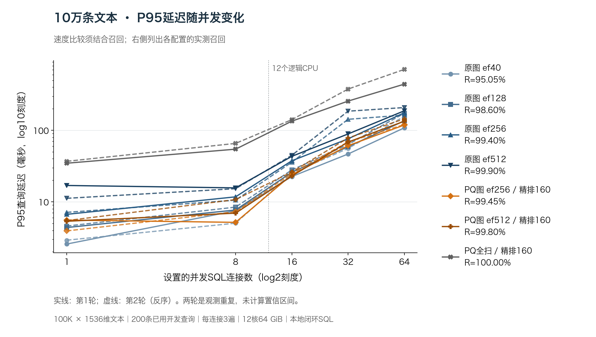
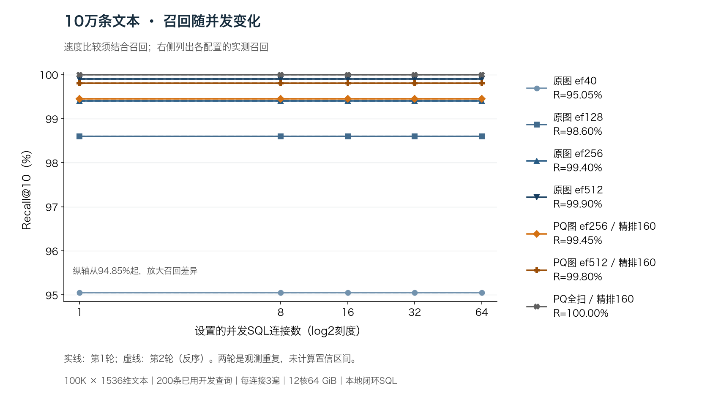

# 10 万条文本：PQ 图与原向量图的并发对照

日期：2026-10-27。环境：macOS ARM64、12 个物理核 / 12 个逻辑 CPU、64 GiB 内存，DuckDB v1.5.2 官方 SDK 与实际 VexDB 扩展。

## 产品结论

**在约 99.4% 平均召回档，PQ 图在本次高并发负载下比原向量图更快；提高连接数没有改变返回集合。但当前 PQ 图尚未达到 99.9% 召回档，不能全面替换原图。**

64 连接时，PQ 图 ef256 / 精排160 为 **99.45% Recall@10、2053–2088 QPS、P95 118.6–120.3 ms**；原图 ef256 为 **99.40%、1189–1218 QPS、P95 163.1–175.9 ms**。按同轮次相除，吞吐为原图的 **1.69–1.76 倍**，P95 减少 **26.2%–32.6%**。这是接近的召回档，两个配置的召回仍相差 0.05 个百分点。

预先登记的加宽对照 PQ 图 ef512 / 精排160 达到 **99.80%**，原图 ef512 达到 **99.90%**。前者虽更快，但本次没有达到相同的 99.9% 最低质量门槛。产品默认仍为 `off`，本轮没有修改默认参数或产品算法。

两轮独立核对 **1,016,400 次真实 SQL 返回列表**。所有预设观测点齐备，每种配置在全部连接数及两轮中返回集合一致。它们重复使用同一批 **200 条已有开发查询**，不是一百万条新查询，也不构成任意业务查询的召回保证。

## 高并发的直接比较

范围均为两轮实测值的最小值到最大值，没有平均两轮的百分位，也没有删去较慢轮次。P95 表示每轮 95% 请求的耗时不超过该值。各列必须结合召回比较；全扫是 PQ 全扫后精排160，并非原向量穷尽搜索。

| 连接数 | 配置 | Recall@10 | QPS（请求/秒） | P95（ms） | P99（ms） |
| ---: | --- | ---: | ---: | ---: | ---: |
| 32 | 原图 ef40 | 95.05% | 2154–2411 | 46.6–55.8 | 75.3–122.5 |
| 32 | 原图 ef128 | 98.60% | 1641–1708 | 58.9–63.4 | 90.7–98.1 |
| 32 | 原图 ef256 | 99.40% | 728–1183 | 75.9–142.4 | 108.3–228.6 |
| 32 | 原图 ef512 | 99.90% | 557–880 | 88.9–185.0 | 122.0–284.0 |
| 32 | PQ 图 ef256 / 精排160 | 99.45% | 1812–2088 | 61.0–68.8 | 96.8–115.0 |
| 32 | PQ 图 ef512 / 精排160 | 99.80% | 1425–1606 | 68.4–78.1 | 103.0–119.4 |
| 32 | PQ 全扫 / 精排160 | 100.00% | 173–217 | 256.0–377.1 | 325.5–458.4 |
| 64 | 原图 ef40 | 95.05% | 1647–2700 | 108.3–156.7 | 170.8–241.6 |
| 64 | 原图 ef128 | 98.60% | 1310–1720 | 135.8–173.0 | 200.5–256.3 |
| 64 | 原图 ef256 | 99.40% | 1189–1218 | 163.1–175.9 | 239.2–255.4 |
| 64 | 原图 ef512 | 99.90% | 807–898 | 187.3–207.9 | 252.0–278.6 |
| 64 | PQ 图 ef256 / 精排160 | 99.45% | 2053–2088 | 118.6–120.3 | 176.5–177.4 |
| 64 | PQ 图 ef512 / 精排160 | 99.80% | 1417–1615 | 134.0–144.5 | 191.0–201.9 |
| 64 | PQ 全扫 / 精排160 | 100.00% | 179–232 | 441.9–710.1 | 527.2–1115.8 |

在较低的 95% 召回门槛下，原图 ef40 本来就很有竞争力，不能只拿 PQ 图与低吞吐的 PQ 全扫比较。64 连接的 PQ 图 ef256 吞吐为 PQ 全扫的 8.98–11.50 倍，但平均召回少 0.55 个百分点，这个速度差不能写成无损收益。

## 并发增加后的变化





PQ 图 ef256 从 32 增到 64 连接，第一轮吞吐几乎不变（-0.04%），第二轮增加 13.29%；P95 分别增为原来的 **1.94 / 1.75 倍**。所以更多连接主要带来更长的尾延迟，没有获得成比例的吞吐增长。16 连接时，该配置为 1769–1897 QPS，P95 23.9–25.1 ms；如业务看重尾延迟，应先评估限制同时执行的请求数，再用真实到达流量验证排队成本。

全部点的平均活跃连接均达到设置值的 95.0% 以上，超过预登记的 80% 门槛；每连接确实完成全部 200 条查询的三遍调用。64 连接时，进程 CPU 用量随配置及轮次约为 5.44–9.52 个核。机器还有桌面及其他应用负载，两轮部分原图和全扫点差异较大；保存了一次进程 CPU 上下文快照，但该快照不是精确的区间 CPU 分解，不能据此把吞吐停滞归因于某个唯一瓶颈。

32/64 连接均超过本机 12 个逻辑 CPU。这是本机封闭循环 SQL 压力测试，没有模拟网络、固定到达速率、请求超时或服务端限流，不能直接当作线上服务容量或端到端延迟承诺。

## 召回、扫描工作量与既定门槛



| 配置 | 每 2000 个真近邻命中数 | 平均 Recall@10 | 每查询平均编码估距 | 相对全扫减少 | 原向量精排数 |
| --- | ---: | ---: | ---: | ---: | ---: |
| PQ 图 ef256 | 1989 | 99.45% | 4,146.66 | 95.85% | 160 |
| PQ 图 ef512 | 1996 | 99.80% | 7,272.615 | 92.73% | 160 |
| PQ 全扫 | 2000 | 100.00% | 100,000 | — | 160 |

估距计数来自独立的非计时原生调用，返回 ID 集合与正式 SQL 一致；不是在计时中加了计数开销，也不是用计数程序的速度冒充 QPS。图上层可能重复估距，不能把次数解释成精确的唯一编码数。

主配置仍为此前冻结的 ef256 / factor16。它相对同倍全扫少 **11/2000 个命中，即 0.55 个百分点**，超过既定的最多 0.2 个百分点，**本次 100K 文本主配置门槛失败**。不能把之前 10K 文本后半查询的 99.9% 直接套到 100K。

加宽对照 ef512 在出结果前已登记，没有依据本次验证集重新选择参数。它少 **4/2000 个命中，恰为 0.2 个百分点**，按整数命中数包含边界判断；同时满足平均估距不超过一半、P95 比全扫至少减少 10% 及并发检查，两轮五档连接共 10 个点全部通过。这个结果仅说明该固定对照在本数据上通过既定工作量门槛，不能改写主配置的失败，也不等于达到 99.9% 或通过新业务查询验收。

审查另按 95% / 99% / 99.9% 最低召回门槛列出预设原图与 PQ 图中 P95 最小的点，保存在 `review.json` 的 `quality_frontiers`。这是相同最低门槛下的描述性比较，不是严格相同召回，也没有增加参数。99.9% 档只有原图 ef512 达标，两档 PQ 图均缺项；全部固定点见图和[70 个观测点明细 CSV](2026-10-27_text-100k-concurrency-results-artifacts/v2/summary.csv)。

平均召回也不能替代逐查询质量：ef256 有 7/200 条查询未全中，最差为 6/10；ef512 有 3/200 条未全中，最差为 8/10。并发没有扩大这些缺口，但它们在本次开发查询中已经存在。

## 漏掉的结果发生在哪一步

正式计时全部结束后，在另行登记的非计时诊断中固定上述两档 PQ 参数：取精排前的 160 个候选 ID，再核对最终 top-10、真值以及两轮正式原生审查的 ID。没有增加新查询、试新参数或把诊断耗时算进 QPS。

| 配置 | 未进入 160 候选的真近邻 | 已进入候选、但精排后未返回 | 独立核对查询数 |
| --- | ---: | ---: | ---: |
| PQ 图 ef256 | 11 | 0 | 200 |
| PQ 图 ef512 | 4 | 0 | 200 |
| PQ 全扫 | 0 | 0 | 200 |

独立脚本从 600 组实际候选和最终 ID 重算了上表，并核对原生估距次数、候选大小和最终结果是候选子集。当前观测到的损失发生在**获得候选的阶段**，后续精排没有丢掉已进入候选的真近邻。下一步若要达到 99.9%，应优先评估补充候选或受控回退方案，并计入新增估距和读取成本；单纯修改已经正确完成的最终排序没有解决这批漏召回的依据。新的方案应先登记、再在新查询上验收，本轮不继续利用已看过的 200 条查询挑参数。

## 构建与存储

新建并保存一份 100K × 1536 维 PQ 索引，沿用 m=16、ef_construction=100、单 worker、自动 M=384。构建内部耗时 **1121.68 秒，约 18.7 分钟**；构建子进程总耗时 1131.1 秒，另含加载及准备探测。两轮查询进程分别耗时 680.7 / 805.8 秒。固定两小时实验窗口内完成，没有恢复先前已结束的队列。

| 计费项 | 实测值 | 范围 |
| --- | ---: | --- |
| PQ 编码 | 38,400,000 B | 每条 384 B，不含其他结构 |
| 码本 | 1,572,864 B | 不含运行时查表和对象 |
| 建索引前整库文件 | 983,838,720 B | 含表和原向量 |
| 建索引后整库文件 | 1,806,184,448 B | 含原表、原向量、图及 PQ 保存内容 |
| 构建进程峰值 RSS | 3.25 GiB | 含加载、构建和准备探测全过程 |
| 两轮查询观测点 RSS 范围 | 0.72–3.02 GiB | 整个进程的观测点前后读数，随执行顺序及宿主内存状态变化 |

所有方法共享同一份保留原向量的 PQ 索引和图连接。`off` 执行原有原向量图搜索，不读 PQ 距离；这避免混入不同图结构，但**没有额外构建一个无 PQ 索引作完整内存对照**。查询 RSS 也不是每种算法的独占常驻内存，不能从这些读数得出总内存减少 30% 的结论。

构建期间两次各 1 秒的采样均看到图插入/邻居选择，不能代表完整构建耗时分解；构建耗时也包含这次诊断影响。ARM 原向量距离入口的枚举值 0 对应 NEONV8，没有把原图故意降为标量对照。

## 方法与复核证据

- **数据**：100,000 条、1536 维归一化 DBpedia 文本 embedding；200 条此前已使用的分离库行代理查询。真值沿用已审查的 float64 全量距离 top-10。本轮使用 L2，没有新增 cosine 性能结论。原过夜研究两组各 256 条保留查询未打开。
- **负载**：七配置 × 五连接档 × 两轮；每连接独立执行全部 200 查询三遍，每遍随机顺序，单连接同一时刻最多一请求，`threads=1`。每个观测点调用数为 600 × 连接数，共 70 点、1,016,400 次。第二轮反转整个观测点顺序。
- **计时**：prepared SQL 执行、物化和读取返回 ID 在每请求计时内；`Value` 构造、Prepare、暖身和随机顺序生成在外。QPS 使用整个观测点墙钟，包含记录与 worker 收尾。已加载索引后的 `first_ms` 不等于冷磁盘启动。
- **计划与正确性**：实际 `EXPLAIN` 分别出现 `hnsw` / `pq-graph` / `pq-full-scan` 的 `VEXDB_INDEX_SCAN`；关闭小库全表阈值以固定入口。每次保存请求起止纳秒、连接、遍次、查询号和真实返回 ID，独立重算命中、百分位、吞吐、查询权重和连接重叠。
- **冻结与审查**：源码、数据、扩展、SDK、协议、保存数据库、每轮结果均留有哈希。独立审查程序在正式结果出现前冻结，并先用 48 次冒烟及故意破坏耗时的负对照检查。正式结果未覆盖，诊断编译和执行均在两轮结束后。
- **边界**：单图构建种子、已有代理查询、共享桌面、本地 SDK；未完成多种子、新业务查询、Linux/x86、三引擎全量 spec 或网络服务压力验收。本轮没有产品源码改动，没有提交、推送或发布。

运行目录：`build/product-tests/text-100k-concurrency-20261027/`。主要证据：

| 文件 | 内容 |
| --- | --- |
| `protocol.json`、`frozen-source/`、`reviewer-manifest.json` | 出结果前的参数、源文件及独立审查程序 |
| `state.json`、`coordinator.log`、`build.log`、`round1.log`、`round2.log` | 实际执行、耗时和终态 |
| `fixture.json`、`fixture/metadata.csv`、`fixture/vectors.duckdb` | 构建元数据、保存数据库及其哈希 |
| `round1/`、`round2/`、`round*-hashes.json` | 全部请求、返回 ID、计时、计划、worker 明细和结果哈希 |
| `review.json`、`summary.csv`、`per-query.csv` | 独立重算结果、既定门槛和逐查询质量 |
| `candidate-audit-protocol.json`、`candidate-pool-audit/pools.csv`、`candidate-pool-review.json` | 固定参数的非计时漏召回定位 |
| `figure-qa.json`、`final-verification.json` | 图形检查及最终证据核对 |

测试入口位于 `vexdb_duckdb/test/benchmark/`：`vex_text_concurrency_benchmark.cpp`、`run_text_concurrency.py`、`review_text_concurrency.py`；补充诊断为 `audit_text_candidate_pools.cpp` 和 `review_text_candidate_pools.py`。程序拒绝覆盖现有正式结果，新跑应使用新目录和明确的新协议。现有冻结输入可以只读核对：

```bash
python3 vexdb_duckdb/test/benchmark/run_text_concurrency.py verify \
  --run build/product-tests/text-100k-concurrency-20261027
```

图表数据及图片哈希见附件目录的 `v2/chart-source.json`。图中实线/虚线分别是两轮，未计算置信区间；横轴为 log2，P95 纵轴为 log10，召回纵轴从 94.85% 起，均明确标注。图形初版和修订版均保留，正文使用经实际查看的修订版。

结合此次结果，产品下一步优先做两件事：用新查询验证接近 99.4% 档的速度收益是否成立；为严格 99.9% 档设计可计费的候选补充/回退路径。限制并发的服务策略也需另测到达队列，不能把本轮封闭循环下较低连接数的延迟直接当成上线后的响应时间。
